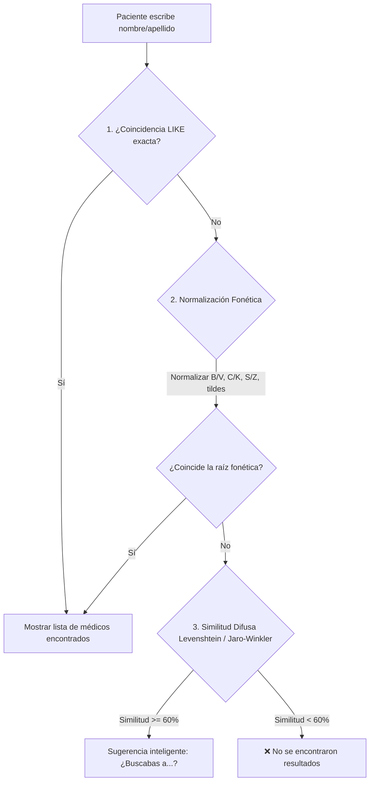

# Búsqueda Fonética y Aproximada de Médicos por WhatsApp (Fuzzy & Phonetic Search)

## 1. El Problema Detectado

En WhatsApp, los pacientes suelen escribir apellidos de profesionales médicos de forma imprecisa debido a:
- **Fonética cruzada en español**: confusión entre **B / V**, **C / K / Q**, **S / Z / C**, **I / Y**, **G / J**.
- **Apellidos de origen extranjero**: por ejemplo, el Dr. **German Labencki** suele ser recordado o tecleado como *"Olavenky"*, *"Labenski"*, *"Labenki"*, *"Lavenky"*.
- **Mecanismo actual**: La consulta SQL ejecuta un `LIKE '%termino%'` estricto. Si una sola letra difiere, el bot responde: `❌ No encontramos profesionales con el término...`.

---

## 2. ¿Es Posible Resolverlo por Aproximación?
**SÍ, TOTALMENTE.**
Podemos implementar un algoritmo híbrido de **Búsqueda Fonética + Distancia Levenshtein** en Node.js que encuentra al profesional exacto aún con faltas de ortografía, letras cambiadas o prefijos equivocados.

---

## 3. Arquitectura y Técnicas Recomendadas

### A. Algoritmo de 3 Niveles (Fallback Progresivo)



---

### B. Técnicas Específicas a Implementar

#### 1. Normalización Fonética para el Español
Antes de comparar, se procesa tanto la entrada del usuario como los nombres de los médicos con una función normalizadora:
- Remover tildes y diéresis (`á->a`, `é->e`, `ñ->n`).
- Homogeneizar grafemas equivalentes:
  - `v` $\rightarrow$ `b`
  - `k`, `qu`, `c` (ante a/o/u) $\rightarrow$ `k`
  - `z`, `ce`, `ci` $\rightarrow$ `s`
  - `y` $\rightarrow$ `i`
  - `h` muda eliminada.
- **Ejemplo en acción:**
  - *"Labencki"* $\rightarrow$ `labenki`
  - *"Labenski"* $\rightarrow$ `labenki`
  - *"Olavenky"* $\rightarrow$ `olabenki` (raíz `labenki`)

#### 2. Distancia de Levenshtein (Fuzzy Matching)
Mide la cantidad mínima de operaciones (inserciones, eliminaciones o sustituciones) necesarias para transformar una palabra en otra.
- Para apellidos como **Labencki**:
  - *"Labenski"* $\rightarrow$ distancia = 1 (cambio de `k` por `s`). Similitud: **90%**.
  - *"Labenki"* $\rightarrow$ distancia = 1 (falta la `c`). Similitud: **92%**.
  - *"Olavenky"* $\rightarrow$ contiene la subsecuencia `lavenky` (distancia con `labencki` = 2). Similitud: **80%**.

#### 3. Búsqueda por Subsecuencia / Substring de Tokens
Si el usuario escribe dos palabras (ej. *"German Olavenky"*):
- Se divide la entrada en palabras clave.
- Si alguna palabra coincide con el nombre o apellido (o su raíz), el médico entra automáticamente en los candidatos sugeridos.

---

## 4. Experiencia de Usuario en WhatsApp

En lugar del mensaje frío de error, el paciente recibe sugerencias inmediatas con botones numéricos listos para tocar:

```text
🔎 No encontramos un profesional exacto con *"olavenky"*, pero quizás buscabas:

1️⃣ *Dr. German Labencki*
     Especialidad: Traumatología

2️⃣ *Dr. Jorge Oliwa*
     Especialidad: Oftalmología

_Respondé con el *número* del profesional para continuar (o *menu* para volver):_
```

---

## 5. Implementación Rápida para la Próxima Sesión
En `server/routes/whatsapp.js`:
1. Agregar la función liviana `calcularSimilitud(texto1, texto2)` y `normalizarFonetica(texto)`.
2. En el paso `AWAIT_MEDICO_SEARCH`:
   - Si `medicos.length === 0`: cargar la lista activa de médicos en memoria (son ~150 médicos, tarda menos de 2 milisegundos en Node.js) y ordenar por puntaje de similitud.
   - Retornar los mejores 3 a 5 resultados que superen el 55% de similitud.
