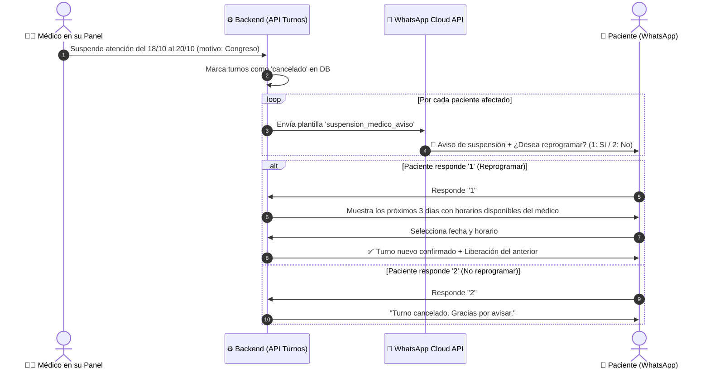

# Arquitectura y Diseño: Notificación Automática y Reprogramación por WhatsApp ante Cancelación Médica

## 1. Respuesta a Preguntas Frecuentes

### ¿Si un paciente agenda un turno desde la página web, le llega el recordatorio de WhatsApp?
**SÍ, TOTALMENTE.**
Tanto la página web (`React + Vite`) como el panel administrativo, la recepción y el Bot de WhatsApp operan sobre la misma base de datos centralizada MySQL (`oscarsoft_turnos`).
- Cada vez que se reserva un turno desde la web, se registra en la tabla `turnos` con estado `asignado` y las banderas `recordatorio_48h_enviado = 0` y `recordatorio_2h_enviado = 0`.
- El servicio en segundo plano (**Cron Job** en `cronRecordatorios.js`), que corre cada 15 minutos en el servidor:
  1. Detecta los turnos que cumplen la condición de fecha y teléfono del paciente.
  2. A las **48 horas previas** (estrictamente entre las **11:00 y las 14:00 hs de Argentina**), envía el WhatsApp solicitando confirmación (`1: Sí / 2: Cancelar`).
  3. A las **2 horas previas**, envía la alerta puntual recordatoria del día.
- **Conclusión:** No importa el origen del turno (Web, Bot, Teléfono o Mostrador), el recordatorio por WhatsApp se despacha automáticamente.

---

## 2. Cancelación por Rango de Fechas del Médico + WhatsApp Automático

### ¿Es posible que al suspender fechas se envíe un WhatsApp automático a los pacientes preguntando si quieren reprogramar o cancelar?
**SÍ, es 100% viable y técnicamente nativo con la arquitectura que ya construimos.**

En el endpoint existente `POST /api/medico/suspensiones` (`server/routes/medico.js`), el sistema ya consulta la lista de turnos y pacientes afectados por el rango de fechas (`afectados`).

---

## 3. Flujo Conversacional Diseñado



---

## 4. Particularidades Técnicas y Mejores Prácticas

### A. Regla Mandatoria del Proyecto (`AGENTS.md`)
El texto del mensaje **no debe hardcodearse en código**. Se inserta en la tabla `bot_respuestas` bajo la clave `suspension_medico_aviso` para que la clínica o el administrador puedan modificarlo desde el Panel Admin:
```text
⚠️ *Aviso Importante de Atención Médica*

Hola *{paciente_nombre}*, te informamos que el *Dr. {medico_nombre}* no podrá atender el día *{fecha}* a las *{hora} hs* por: _{motivo}_.

Lamentamos los inconvenientes ocasionados. ¿Qué deseás hacer con tu consulta?
*1* - 🗓 Reprogramar mi turno para otra fecha
*2* - ❌ Cancelar definitivamente
```

### B. Control de Ritmo de Envíos (Rate Limiting / Throttling)
Si un médico suspende una semana completa con 80 pacientes citados:
- **Técnica recomendada:** Enviar los mensajes mediante una cola o bucle con una pausa de **500 ms a 1 segundo entre cada envío** (`await new Promise(r => setTimeout(r, 800))`).
- **Motivo:** Evita bloqueos por ráfagas (burst rate limit) en la API de Meta y garantiza que cada mensaje obtenga su `wamid` de confirmación.

### C. Estado Conversacional en Sesión (`userSessions`)
Al disparar la notificación de suspensión, se registra la sesión temporal del paciente:
```javascript
userSessions.set(telefonoNormalizado, {
  step: 'AWAIT_RESCHEDULE_CHOICE',
  medicoId: turno.medico_id,
  especialidadId: turno.especialidad_id,
  pacienteId: turno.paciente_id,
  turnoOriginalId: turno.id
});
```
- Si el usuario responde `1`: El bot reutiliza directamente la función `handleFlowEspecialidad` o consulta `getDisponibilidad(medicoId, fecha)` ofreciendo las próximas fechas disponibles del mismo profesional.
- Si el usuario responde `2`: Se cierra la sesión cordialmente.

### D. Registro de Auditoría en Panel Médico
En la vista del médico, donde actualmente se listan los pacientes afectados, se puede añadir una columna de estado:
- `WhatsApp Enviado`: ✅ (con hora de despacho).
- `Respuesta`: Pendiente / Reprogramado / Cancelado.

---

## 5. Próximos Pasos para Implementar
Cuando retomes la aplicación:
1. Crear la plantilla en `bot_respuestas`: clave `suspension_medico_aviso`.
2. Conectar el bucle de envío asíncrono en `router.post('/suspensiones')` de `server/routes/medico.js`.
3. Agregar el caso `AWAIT_RESCHEDULE_CHOICE` en el enrutador de mensajes de `server/routes/whatsapp.js`.
